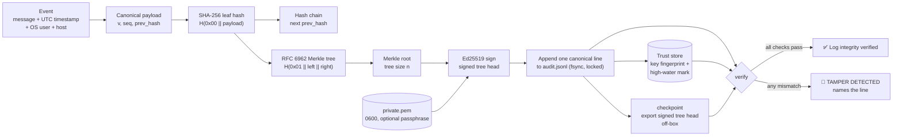

# aegis-audit

[](https://github.com/Khizar226/aegis-audit/actions/workflows/ci.yml)


**A cryptographic flight recorder for AI agents.**

`aegis-audit` is a CLI that writes a **tamper-evident, Ed25519-signed audit log** of what an
AI agent did. Every event is hashed into an RFC 6962 Merkle tree and chained to the previous
event. Every line carries its own signed tree head. If anyone edits, deletes, reorders,
truncates, or re-signs the log afterwards, `verify` names the exact line that was changed.

```text
╭─────────────────────────────────────────────────────────────────────────────────────────╮
│ ✅ Log integrity verified                                                               │
│ 3 entries · root c8bb9d83c5699dd7… · key 593bdf992335103a… · key pinned via trust store │
╰─────────────────────────────────────────────────────────────────────────────────────────╯
```
```text
╭────────────────────────────────────────────────────────────────╮
│ 🚨 TAMPER DETECTED                                             │
│ line 3: event content does not match its hash (modified)       │
│ line 3: signed tree head does not match recomputed Merkle root │
╰────────────────────────────────────────────────────────────────╯
```

---

## Why AI agents need tamper-evident logs

Autonomous agents now run shell commands, edit code, call APIs, and move data, often unattended.
When something goes wrong, the log is the only witness. But the log usually lives on the same
machine, writable by the same process that did the damage:

* A **prompt-injected agent** can be told to clean up after itself ("delete the last entry").
* A **compromised host** lets an attacker rewrite history before anyone looks.
* **Compliance and incident response** need to prove the record is the *original* record,
  not just that a file exists.

Plain text logs can't prove any of that. `aegis-audit` turns "trust me" into a mathematical
check:

| Guarantee | Mechanism |
|---|---|
| Any edit to any event is detected | SHA-256 leaf hashes inside an RFC 6962 Merkle tree |
| Deleted, inserted, or reordered lines are pinpointed | Sequence numbers plus a `prev_hash` chain |
| Only the key holder can extend the log | Ed25519 signature on every line's tree head |
| Key substitution is detected | Fingerprint pinned outside the log directory, at `init` |
| Truncation and rollback are detected | High-water mark in the trust store, plus exportable signed checkpoints |

Each event automatically records a **UTC timestamp**, the **OS user**, and the **hostname**,
and all of it is inside the signed hash.

---

## Installation

Requires Python 3.9+.

```bash
git clone https://github.com/Khizar226/aegis-audit.git
```

```bash
cd aegis-audit
```

```bash
pip install .
```

You can also run it without installing: `python main.py <command>` or `python -m aegis_audit <command>`.

---

## Usage

### 1. Create a signing key

```bash
aegis-audit init
```

```text
╭────────────────────────────── aegis-audit init ───────────────────────────────╮
│ Keypair created                                                               │
│ Private key: .aegis/private.pem  (keep secret, mode 0600)                     │
│ Public key:  .aegis/public.pem                                                │
│ Fingerprint: 593bdf992335103a8d19d261fbb1a5cbbdc9c0a11b8d1bd180a23f3dc8975655 │
│ Pinned in:   ~/.config/aegis-audit/trusted_keys.json                          │
│ Also store the fingerprint OFF this machine and verify with --fingerprint.    │
╰───────────────────────────────────────────────────────────────────────────────╯
```

Set `AEGIS_KEY_PASSPHRASE` before running `init` to encrypt the private key at rest. Use
`--dir` / `-d` on any command to use a directory other than `./.aegis`.

### 2. Record what the agent does

```bash
aegis-audit log "agent started task #812: refactor billing module"
```

```bash
aegis-audit log "agent ran: pytest -q (41 passed)"
```

Each call verifies the existing log first. It **refuses to sign on top of a tampered log**,
then appends one canonical JSON line and fsyncs it. Concurrent writers are serialized with an
inter-process lock.

<details>
<summary>What one line looks like</summary>

```json
{
  "entry_hash": "2aad855e4129e9cba5d1e3bfd602d91dabb6507e893d6f00ecb47b102b513afe",
  "host": "vm",
  "key_id": "593bdf992335103a8d19d261fbb1a5cbbdc9c0a11b8d1bd180a23f3dc8975655",
  "merkle_root": "2aad855e4129e9cba5d1e3bfd602d91dabb6507e893d6f00ecb47b102b513afe",
  "message": "agent started task #812: refactor billing module",
  "prev_hash": "0000000000000000000000000000000000000000000000000000000000000000",
  "seq": 0,
  "signature": "ZoZA6V6PgsJ2PkeiAtICCPUVOUdd/EgET1tDJMIaiN+2BzZIkxeKhRVODLAqr+UPB9Z6XinaVCgTg/CLdofrAg==",
  "timestamp": "2026-11-04T17:43:52.780297+00:00",
  "tree_size": 1,
  "user": "root",
  "v": 2
}
```
On disk, each line is compact canonical JSON with sorted keys and no whitespace.
</details>

### 3. Verify

```bash
aegis-audit verify
```

This recomputes every leaf hash, every Merkle root, the hash chain, and every signature. It
shows the Merkle root history and ends with `✅ Log integrity verified` (exit code 0) or
`🚨 TAMPER DETECTED` (exit code 1), listing the offending lines.

```bash
aegis-audit verify --fingerprint 593bdf992335103a8d19d261fbb1a5cbbdc9c0a11b8d1bd180a23f3dc8975655
```

```bash
aegis-audit verify --pubkey /secure/aegis-public.pem --checkpoint /secure/cp-2026-11-04.json
```

```bash
aegis-audit verify --require-pin --json
```

| Option | Purpose |
|---|---|
| `--fingerprint` / `AEGIS_TRUSTED_FINGERPRINT` | Pin the key by the fingerprint printed at `init` |
| `--pubkey PATH` | Verify against a public key stored somewhere the agent can't write |
| `--checkpoint PATH` | Prove the log still contains a previously exported tree head (catches truncation and rollback) |
| `--require-pin` | Fail if no trusted key is available (recommended in CI) |
| `--show N` | Number of history rows to display (`0` hides the table) |
| `--json` | Machine-readable verdict |

### 4. Inspect and anchor

```bash
aegis-audit history -n 50
```

```bash
aegis-audit checkpoint -o /mnt/worm-bucket/aegis-$(date +%F).json
```

A checkpoint is the latest signed tree head (tree size, root, entry hash, key id, signature).
Ship it somewhere the agent can't reach, such as object storage with retention, another host,
or a ticket. Any later log must contain it as a prefix.

---

## Architecture



What `verify` checks for every line *n*:

1. The line is exact canonical JSON with exactly the expected fields.
2. `seq == n` and `prev_hash` equals the previous line's `entry_hash`.
3. `entry_hash == H(0x00 || canonical(payload))`.
4. `merkle_root` equals the recomputed RFC 6962 root over entries `0..n`. This uses an
   O(log n) incremental accumulator, cross-checked in tests against the recursive reference
   definition.
5. `key_id` equals the trusted key's fingerprint, and the Ed25519 signature over
   `"aegis-audit:v2:sth:" || canonical(tree_size, merkle_root, entry_hash, key_id)` is valid.
6. The timestamp is UTC. A timestamp that goes backwards produces a warning.

Then the whole log must contain the trust-store high-water mark and any `--checkpoint` as a prefix.

```text
aegis_audit/
├── cli.py      # Typer commands, Rich rendering (untrusted text rendered literally)
├── store.py    # append / verify / checkpoint, trust store, locking
├── merkle.py   # RFC 6962 tree + incremental accumulator
└── crypto.py   # Ed25519 keys, fingerprints, signatures
```

---

## Adversarial Testing Results

After Phases 1–2 I attacked the tool as someone covering their tracks. The **attacker model**
is someone with write access to the audit directory: a prompt-injected agent, or an intruder on
the box. A harness generates each attack against a fresh 5-event log and treats any `✅` from
`verify` as a **bypass**. Every attack is now a regression test in `tests/test_audit.py`, run in
two modes: with only the default trust store, and with explicit off-box anchors after the
attacker has also wiped the trust store.

### Results: v1 vs. v2

| # | Attack | v1 | v2 | How v2 stops it |
|---|---|---|---|---|
| 1 | Edit one event's message | detected | detected | Leaf hash mismatch |
| 2 | Delete a line from the middle | detected | detected | `seq` gap plus broken `prev_hash` chain, reported by line number |
| 3 | Swap the order of two lines | detected | detected | Same |
| 4 | Modify a timestamp | detected | detected | The timestamp is inside the signed leaf hash |
| 5 | Rewrite an earlier line's `merkle_root` / `signature` | **bypass** | detected | Every line's signed tree head is verified; v1 only checked the last line |
| 6 | Truncate the last 2 lines | **bypass** | detected | Trust-store high-water mark; `--checkpoint` |
| 7 | Truncate the log to empty | **bypass** | detected | Same |
| 8 | Delete the log file | **bypass** | detected | `init` creates the file; a missing log is tampering |
| 9 | Duplicate the last line (odd leaf count) | **bypass** | detected | RFC 6962 tree; v1 gave `[a,b,c]` and `[a,b,c,c]` the **same root** (CVE-2012-2459 class) |
| 10 | Roll back to an older copy of the log | **bypass** | detected | High-water mark; `--checkpoint` |
| 11 | **Signature laundering**: edit an old event, then let the next legitimate `log` re-sign it | **bypass** | detected | `log` verifies the whole log and refuses to append to a tampered one |
| 12 | Re-sign with a forged key (swap `public.pem`) | **bypass** | detected | Fingerprint pinned outside the log directory; `--pubkey` / `--fingerprint` |
| 13 | Rewrite history with the **stolen real key** | **bypass** | detected | High-water mark / checkpoint: the forged history's root differs |
| 14 | Corrupt a line's JSON | detected | detected | Parse error reported |
| 15 | Add an unsigned field (`"note": "approved by security"`) | **bypass** | detected | Exact field set required |
| 16 | Inject a blank line | **bypass** | detected | Exact canonical form required |
| 17 | Duplicate JSON key: `grep` shows the fake value, the parser keeps the real one | **bypass** | detected | Line must equal its canonical re-serialization |
| 18 | Re-encode a character as `A` | **bypass** | detected | Same |

**v1: 13 of 18 attacks bypassed verification. v2: 0 of 18**, both with the default trust
store and with explicit anchors.

### Round 2: attacking the v2 defenses

| Attack | Result |
|---|---|
| Checkpoint re-signed with an attacker key | Rejected: checkpoint signature must match the trusted key |
| Malleated Ed25519 signature (S + L) | Rejected |
| Agent logs `[bold green]✅ Log integrity verified[/]` to spoof the verdict in the terminal | Fixed: untrusted text is rendered literally, and control, format, and line-separator characters are shown as `\uXXXX` |
| Message containing U+2028 | **Found a crash**: `checkpoint` used `str.splitlines()`, which splits on U+2028. Fixed to split on `\n` only |
| Message containing undecodable bytes (lone surrogates) | **Found a crash** in `log` (a denial-of-logging vector). Fixed: bytes are kept, escaped as `\xNN` |
| 12 concurrent `log` processes | Chain stays linear (inter-process lock), and all 12 entries verify |

### Residual risk (what no local log can prove)

Be clear about the limits. An attacker **who runs as the same OS user and also deletes the
trust store** can truncate the log, and `verify` will pass from the log alone. In that case
`verify` loudly reports **UNPINNED key**, `--require-pin` turns it into a failure, and any
off-box `--fingerprint` or `--checkpoint` still catches it (tested). An attacker with the
private key can also append *new* false events going forward. Signatures prove authorship by
the key, not truthfulness. For high-assurance setups:

* keep the private key off the agent's host or behind a signing service, or at least use `AEGIS_KEY_PASSPHRASE`;
* export a `checkpoint` regularly to write-once storage;
* run `verify --require-pin --fingerprint <fp> --checkpoint <latest>` from a separate machine or CI job.

This is the same model as Certificate Transparency: a log proves its own consistency, and
external witnesses prove it was never forked or rolled back.

---

## Development

```bash
pip install -e ".[dev]"
```

```bash
pytest -v
```

The test suite has 107 tests. It covers the 19 regression attacks in both trust modes, the
round-2 cases, RFC 6962 conformance for every tree size from 0 to 33 plus 100 and 257,
passphrase keys, concurrency, and legacy-console encoding. CI runs on Python 3.9–3.13
(Ubuntu) and Windows, plus an end-to-end smoke test.

## License

[MIT](LICENSE)
